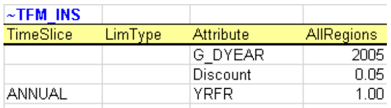
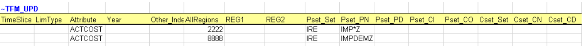

# Insert and update

The three workhorse tags write parameter values into a layer:

| Tag | Writes | Selects items by | Reads existing values | Speed |
| --- | --- | --- | --- | --- |
| `~TFM_DINS` | absolute values | exact names only | no | fastest |
| `~TFM_INS` | absolute values | rules: wildcards, lists, sets, topology | only for conditions | medium |
| `~TFM_UPD` | new values computed from existing ones, or absolute values where a value already exists | rules, like INS | yes ([seed values](files-and-layers.md#seed-values)) | slowest |

All three are accepted in `BY_Trans`, `SubRES_*_Trans`, SysSettings,
trade, regular, NSV and generated parametric files. Each has layouts that
put years, attributes or timeslices across the columns
([Layouts](#layouts-at-ts-tsl)). To copy existing values to other
indexes, see [`~TFM_MIG`](migrate.md).

Choose the simplest tag that can express the data: DINS when every name
is known, INS when a rule picks the items, UPD only when the new value
depends on the existing one.

## Common columns

| Column (aliases) | Meaning |
| --- | --- |
| `Attribute` | The attribute (in the plain layouts). |
| `pset_pn`, `pset_pd`, `pset_set`, `pset_ci`, `pset_co` | Process filters ([filters](values-and-filters.md#process-and-commodity-filters)); DINS takes only `pset_pn`. |
| `cset_cn`, `cset_cd`, `cset_set` | Commodity filters; DINS takes only `cset_cn`. |
| `Region` | Region(s) or region groups, comma list allowed. |
| `Year` (`yr`) | Year; `0` for the interpolation option; a range for period attributes. |
| `TimeSlice` (`ts`), `LimType` (`bd`), `Curr` (`currency`) | The other indexes. |
| `Other_Indexes` (`oth_ind`) | Extra index(es) some attributes need; several, separated by `~` ([below](#several-extra-indexes)). |
| `Stage`, `SOW` | Stochastic indexes. |
| `Value` (`allregions`, `valfield`) | The value for every region of the row that has no column of its own. |
| *region names* | One column per region: the value for that region. |
| `attrib_cond`, `val_cond`, `avc_year`, `avc_timeslice`, `avc_limtype` | Conditions on existing values (INS, UPD; [conditions](values-and-filters.md#conditions-on-existing-values)). |
| `SourceScen` | UPD only: the layer(s) to read existing values from. |
| `Top_Check` (`top_chk`) | INS, UPD: when filled, an item with a process and a commodity is kept only if they are connected: `a` (either direction), `i` (input), `o` (output); `n` turns the check off. |
| `TS_Filter` | DINS, INS: whole-series replacement between layers ([below](#ts_filter-replace-a-whole-time-series)). |

The complete list, with all aliases, is in the [tag catalog](reference.md).

## ~TFM_DINS

**Direct insert**: the rows are fully enumerated. Names are read
literally — `pset_pn` holds one process name, `cset_cn` one commodity
name — with no wildcards and no other filter columns. Regions may still be
a comma list or a region group.

Because no rule has to be resolved, DINS is the fastest way to bring large
volumes of data into a model, and it avoids the accidental matches that a
literal `_` causes in INS.

| ~TFM_DINS | | | | | |
| --- | --- | --- | --- | --- | --- |
| **Attribute** | **pset_pn** | **cset_cn** | **Year** | **REG1** | **REG2** |
| ACT_BND | MINCOA1 | | 2030 | 120 | 80 |
| FLO_SHAR | EGASCC | GAS | 2030 | 0.4 | 0.5 |

A value for a process and commodity that are not connected in the
topology is dropped.

## ~TFM_INS

**Insert**: absolute values for every item a rule selects. All
[filters](values-and-filters.md#process-and-commodity-filters), comma
lists and wildcards are available.

In this example from DemoS_001, an INS table declares three constants by
row (`G_DYEAR`, `Discount`, `YRFR`).

| ~TFM_INS | | | | |
| --- | --- | --- | --- | --- |
| **Attribute** | **pset_set** | **pset_ci** | **Year** | **AllRegions** |
| NCAP_BND | ELE | COA | 2030 | 0 |
| PRC_AOFF | ELE | NUC | BOH-2027 | 1 |

The first row forbids new coal power capacity in 2030 in all regions; the
second makes nuclear plants unavailable until 2027. A row with an empty
filter column is not restricted by that column, but at least one process
filter is needed for attributes that have a process.

### Several extra indexes

Some attributes have more indexes than there are columns, for example a
second region or commodity. Give them in `Other_Indexes`, separated by
`~`; Veda gives each part to the index it belongs to.

| Attribute | Region | pset_pn | cset_cn | Other_Indexes | Value |
| --- | --- | --- | --- | --- | --- |
| IRE_FLOSUM | REG1 | IMPCOA1 | COA | `imp~out~INDCO2` | 0.1 |
| IRE_CCVT | REG2 | | GAS | `REG1~GAS` | 1 |

### ~TFM_INS-TXT

INS for the attributes whose values are text, which override what the
declaration tables set: `PRC_PCG`, `PRC_TSL`, `PRC_VINT`, `COM_LIM`,
`COM_TSL`, `COM_TYPE`. Accepted in SysSettings only.

## ~TFM_UPD

**Update**: compute new values from existing ones. A UPD row selects
items exactly like INS, then looks for **existing values** of its
attribute for those items, and writes a new value for each one found.
Where no value exists, nothing is written.

The example sets prices (`ACTCOST`) for the dummy import processes
(`IMP*Z`) wherever they already have one.

### Value cells in ~TFM_UPD

The value cell may start with an operator:

| Cell | New value |
| --- | --- |
| `*1.2` | existing × 1.2 |
| `/2` | existing ÷ 2 |
| `+5` | existing + 5 |
| `-5` | existing − 5 |
| `~-5` | −5 (the `~` marks an absolute value) |
| `40` | 40 |

!!! warning "A leading minus is subtraction"

    In UPD (and MIG) cells, `-5` means "subtract 5". To write the value
    −5, use `~-5`.

### Where existing values come from

From the [seed values](files-and-layers.md#seed-values) of the layer:
`BASE`, the repositories, trade and demand layers, and regular layers
whose name sorts at or before the UPD's own layer. When several of those
layers hold a value for one item, a regular layer beats a trade, demand
or repository layer, which beats `BASE`; among regular layers, the one
whose name sorts last is used. `SourceScen` (a layer name or comma list)
restricts the source to the named layers; use it whenever the source
matters.

A UPD row does not see values written by other UPD rows of the same
table, and runs side by side with `~TFM_MIG`
([processing order](processing-order.md)).

### Updating is not the same as replacing

Any of these tags replaces a value only in the sense of the case: a
`Scen_HighGas` row writes a value in layer `HighGas`, and a case that
includes `HighGas` after `BASE` uses it. UPD is needed only when the new
value must be **computed** from the old one, or written only where an old
one exists. In `BY_Trans` and `SubRES_*_Trans`, which belong to the same
layer as their parent, an INS or DINS row for the same item overwrites the
template's value directly.

### Performance

UPD is the heaviest tag: each row fetches existing values from a
potentially large table. A UPD table with few rows, each touching many
records, is fine; a long table with one row per year and sub-sector can
take minutes. When the update is really a fixed set of new numbers, write
it with DINS or INS instead. [UPD tables](../upd-tables.md) shows a
worked example: an update that took four minutes, replaced by a
`~TFM_FILL-R` + `~TFM_DINS` pair that takes a fraction of the time.

## Layouts: -AT, -TS, -TSL

The plain tags have one value per row, under region columns or
`AllRegions`. The layouts put another index across the columns instead,
so source data can be pasted as it is:

| Suffix | Column headers are | Exists for |
| --- | --- | --- |
| `-AT` | attribute names | `~TFM_DINS-AT`, `~TFM_INS-AT`, `~TFM_UPD-AT`, `~TFM_MIG-AT` |
| `-TS` | years (a time series), plus `0` for the interpolation option | `~TFM_DINS-TS`, `~TFM_INS-TS`, `~TFM_UPD-TS`, `~TFM_MIG-TS` |
| `-TSL` | timeslices | `~TFM_DINS-TSL`, `~TFM_INS-TSL` |

The naming is counter-intuitive: **`-TS` means years** ("time series")
and **`-TSL` means timeslices**.

With a layout, the index that is across the columns is not a column of
its own; the region then comes from a `Region` column or the tag text
(`~TFM_INS-TS: Region=Reg_Dev`). The attribute of a `-TS` or `-TSL` table
can be on the tag (`~TFM_INS-TS: attribute=SHAPE`) or in an `Attribute`
column, which lets one table carry several attributes.

**~TFM_INS-TS** — years across:

| ~TFM_INS-TS | | | | | | | |
| --- | --- | --- | --- | --- | --- | --- | --- |
| **pset_ci** | **pset_co** | **Attribute** | **cset_cn** | **2020** | **2030** | **0** | **LimType** |
| GASNGA | HH2 | FLO_EMIS | CO2CAP | 0.9 | 0.95 | | |
| ELCCurt | HH2 | FLO_SHAR | ELC | 0 | | 3 | LO |

!!! tip "Use `-TS` for any series that should be interpolated"

    In a `-TS` table the year columns form a series, and column `0` is the
    rule for interpolating and extrapolating it. In a plain table with year
    columns, each column is an isolated data point. For a bound, the years
    between the points are then simply unbounded.

**~TFM_DINS-TS** — the same, fully enumerated, here with the attribute
and limit type on the tag:

| ~TFM_DINS-TS: attribute=COM_BNDPRD; LimType=LO | | | | | |
| --- | --- | --- | --- | --- | --- |
| **Commodity** | **Region** | **2019** | **2020** | **2030** | **0** |
| pc_2eh | Asia_Dev | 0.374 | 0.293 | 0.311 | 5 |
| pc_2eh | Belgium | 0.041 | 0.037 | 0.054 | 5 |

**~TFM_INS-AT** — attributes across, several attributes per row:

| ~TFM_INS-AT | | | | |
| --- | --- | --- | --- | --- |
| **pset_set** | **Region** | **Year** | **PRC_AOFF** | **START** |
| E_Coal | Bangladesh,Indonesia,Vietnam | 2040-EOH | 1 | |
| E_Coal | Bangladesh,Indonesia,Vietnam | | | 2025 |

The first row switches coal plants off from 2040 to the end of the
horizon; the second sets their first availability year.

## TS_Filter: replace a whole time series

Normally, when a later layer in a case gives a value for an item, it
replaces the earlier layer's value **year by year**: a later 2030 value
leaves the earlier 2020 and 2050 values in place, and TIMES interpolates
across the mix. The `TS_Filter` column of `~TFM_INS` and `~TFM_DINS`
changes this for the rows that carry it, for each item (all indexes
except year):

| `TS_Filter` | Effect when the case is assembled |
| --- | --- |
| `1` | The series comes only from the latest layer in the case whose rows for that item have `TS_Filter` 1; rows for the item in every other layer are dropped. |
| `0` | Rows for the item in layers earlier in the case are dropped; later layers still override year by year. |
| empty | Normal behaviour. |

Year-0 rows (interpolation options) are never dropped.
