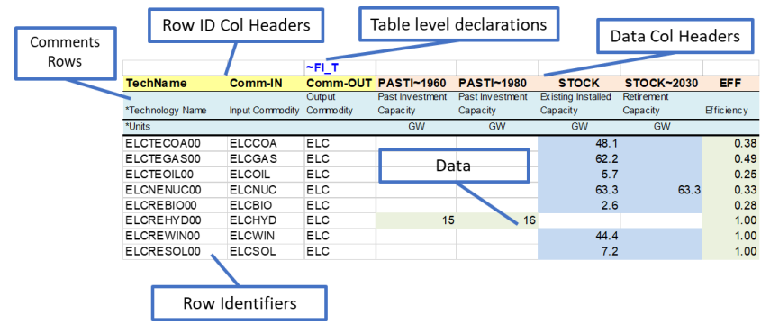

# Declarations (RES templates)

These tags build the Reference Energy System: they declare commodities
and processes, connect them, and give them their base data. They are
used in base-year templates (`VT_*`) and technology repositories
(`SubRES_*`); `~FI_Comm` is also accepted in SysSettings.

Declaration tables take names literally: **no wildcards** here.

!!! warning "Declare each process and commodity exactly once"

    Declarations are read in parallel. If the same commodity or process is
    declared twice with different characteristics (for example two
    timeslice levels), the result can change from one sync to the next,
    and cases that combine different files can end up with different
    definitions. For large models, a good practice is to declare all
    commodities in one place, such as SysSettings.

## Commodity Definition Table (~FI_COMM)

Declares commodities and their non-numeric characteristics. One row per
commodity.

| Column (aliases) | Meaning |
| --- | --- |
| `Csets` (`cset`, `sets`, `set`) | Commodity type: `NRG` (energy), `MAT` (material), `DEM` (demand service), `ENV` (emission), `FIN` (financial). **Carries down**: an empty cell takes the value above; if the first row is empty, or the table has no `Csets` column, `NRG`. |
| `Region` | Region(s), comma list allowed. Empty: in a `VT_` file the regions of its book; in SysSettings all regions. Not allowed in SubRES (regions come from [`~TFM_AVA-C`](availability.md)). |
| `CommName` (`commodity`) | Commodity name. |
| `CommDesc` (`description`) | Description. |
| `Unit` | Unit label. Empty: the sector default of [`~DefUnits`](system-settings.md#defunits). |
| `LimType` (`bd`) | Sense of the commodity balance: `LO` (production ≥ consumption), `FX` (=), `UP` (≤), `N` (no balance). Leave empty for the TIMES default: `LO` for NRG, DEM, ENV; `FX` for MAT and FIN. |
| `CTSLvl` (`tslvl`, `timeslicelevel`) | Timeslice level of the balance: `ANNUAL` (default), `SEASON`, `WEEKLY`, `DAYNITE`. |
| `PeakTS` (`peaktimeslice`) | Timeslices for peak monitoring: `ANNUAL` (default) or a comma list of timeslices. |
| `CType` (`type`, `commoditytype`) | Electricity and heat subtypes: `ELC`, `HTHEAT`, `LTHEAT`. |

| ~FI_Comm | | | | | |
| --- | --- | --- | --- | --- | --- |
| **Csets** | **CommName** | **CommDesc** | **Unit** | **CTSLvl** | **CType** |
| NRG | COA | Solid fuels | PJ | ANNUAL | |
| | ELC | Electricity | PJ | DAYNITE | ELC |
| | HET | District heat | PJ | SEASON | LTHEAT |
| ENV | CO2 | Carbon dioxide | kt | | |

!!! warning "CHP outputs need `CType`"

    TIMES recognises the electricity output of a CHP plant by its type,
    not its name. The electricity commodity must have `CType` `ELC`, and
    the heat commodity `LTHEAT` or `HTHEAT`; otherwise CHP ratios do not
    bind.

Veda adds these commodities to every region of every model, so they can
be used without being declared:

- the commodities of TIMES's climate module: CH4-ATM, CH4-LO, CH4-MT,
  CH4-PPB, CH4-UP, CO2-ATM, CO2-GTC, CO2-LO, CO2-PPM, CO2-UP, DELTA-ATM,
  DELTA-LO, FGS-CON, FGS-MT, FORC-CH4, FORC-CO2, FORC-FGS, FORC-KYO,
  FORC-N2O, FORCING, N2O-ATM, N2O-LO, N2O-MT, N2O-PPB, N2O-UP;
- the commodity-type groups NRG, MAT, DEM, ENV, FIN and the process-side
  groups NRGI, NRGO, MATI, MATO, DEMI, DEMO, ENVI, ENVO, FINI, FINO;
- `ACT`, the activity of a process.

## Process Definition Table (~FI_PROCESS)

Declares processes and their non-numeric characteristics. One row per
process. Numbers (costs, efficiencies, lifetimes, bounds) do **not** go
here: they go in [`~FI_T`](#flexible-import-table-fi_t) or in the
insert and update tags.

| Column (aliases) | Meaning |
| --- | --- |
| `Sets` (`set`) | Process type, comma list allowed: `ELE` (power plant), `CHP`, `HPL` (heat plant), `PRE` (generic), `DMD` (demand device), `IMP`, `EXP`, `MIN`, `IRE` (inter-regional trade), `STG`, `STS`, `STK`, `NST`, `IPS` (storage types), … **Carries down**; if the first row is empty, or the table has no `Sets` column, `PRE`. |
| `Region` | Region(s), comma list allowed. Empty: the regions of the file's book. Not allowed in SubRES (regions come from [`~TFM_AVA`](availability.md)). |
| `TechName` (`process`) | Process name, up to 32 characters; keep to 27, as Veda adds suffixes for some generated processes. |
| `TechDesc` (`description`) | Description, up to 255 characters. |
| `Tact` (`activityunit`) | Activity unit. Empty: the sector default of [`~DefUnits`](system-settings.md#defunits). |
| `Tcap` (`capacityunit`) | Capacity unit. Empty: the sector default. |
| `Tslvl` (`timeslicelevel`) | Operational timeslice level. Empty: `DAYNITE` for `ELE` and `CHP`, `SEASON` for `HPL` (when SysSettings' `~TimeSlices` has those levels), `ANNUAL` otherwise. |
| `PrimaryCG` (`pcg`) | The primary commodity group, which defines the activity. Usually left empty: Veda then uses the energy outputs (`NRGO`). Takes **one** commodity name or one group (`NRGO`, `NRGI`, `DEMO`, `DEMI`, `MATO`, …); a comma list is not valid here. |
| `Vintage` | `YES` to track vintages; default `NO`. |

| ~FI_Process | | | | | |
| --- | --- | --- | --- | --- | --- |
| **Sets** | **TechName** | **TechDesc** | **Tact** | **Tcap** | **Tslvl** |
| MIN | MINCOA1 | Domestic coal supply, step 1 | PJ | PJa | ANNUAL |
| ELE | ECOAST | Coal steam plant | PJ | GW | DAYNITE |
| | EGASCC | Gas combined cycle | PJ | GW | |

!!! warning "Different capacity and activity units need `CAP2ACT`"

    `Tact` and `Tcap` are labels. TIMES assumes one unit of capacity
    produces one unit of activity per year. If they differ, give the
    factor (`CAP2ACT`, TIMES `PRC_CAPACT`) in `~FI_T`: 31.536 for GW and
    PJ, 8.76 for GW and TWh. Without it, a 1 GW plant can produce 1 PJ a
    year.

Set `PrimaryCG` only when the activity is not the obvious energy output:
processes whose costs are per unit of input, sinks with no energy output
(set it to the consumed commodity), or processes whose only output is an
emission.

## Flexible Import Table (~FI_T)

`~FI_T` connects processes to commodities (the topology) and gives them
their numbers, in a layout that follows the source data. It is used in
`VT_*` and `SubRES_*` files. Data is imported as given, without rules or
filters.

A `~FI_T` table has two parts:

- **Index columns** on the left, with known headers, say what each row is
  about.
- **Value columns** on the right, whose headers say what the numbers are:
  an attribute, possibly qualified by year, limit type, timeslice,
  currency or region (`INVCOST`, `ACT_BND~UP~2030`, `PASTI~2015`).

The tag cell may sit above any column (`~FI_T` is a floating tag); a
common convention puts it above the first value column, which visually
separates the two parts.

### Index columns

| Column (aliases) | Meaning |
| --- | --- |
| `TechName` (`process`, `pset_pn`) | Process. **Carries down**: rows below with an empty cell belong to the same process. |
| `Comm-IN` (`comm_in`, `commodity-in`, …) | Main input commodity (comma list allowed). |
| `Comm-OUT` (`comm_out`, `commodity-out`, …) | Main output commodity (comma list allowed). |
| `Comm-IN-A`, `Comm-OUT-A` | Auxiliary inputs and outputs (comma lists allowed). |
| `Attribute` (`parameter`, `attr`) | Attribute, when values are given row-wise. |
| `Commodity` (`commname`, `cset_cn`) | Commodity of the value, when it is not the in/out commodity. |
| `Region` | Region(s), comma list allowed. |
| `Year` (`yr`), `TimeSlice` (`ts`), `LimType` (`bd`) | Comma lists allowed: one value per combination. |
| `Curr` (`currency`) | Currency. |
| `Other_Indexes` (`commgrp`, `commodity_group`) | Extra index required by some attributes (a commodity group, a curve number, …). |
| `Stage`, `SOW` | Stochastic stage and state of the world. |

### How the rows are read

- **Topology.** Each `Comm-IN`, `Comm-OUT`, `Comm-IN-A` or `Comm-OUT-A`
  cell connects the row's process to that commodity. A row with topology
  and no values still declares the connection. A second output on the row
  below (`Comm-OUT` only) adds it to the topology.
- **Main versus auxiliary flows.** An efficiency (`EFF`) relates the
  commodities in `Comm-IN` to those in `Comm-OUT`. Any other flow the
  process has — a utility, a co-product, captured CO2, the electricity of
  a heat plant — goes in `Comm-IN-A` / `Comm-OUT-A`, with `INPUT` /
  `OUTPUT` coefficients.
- **Which commodity a value belongs to.** The `Commodity` column if
  given; otherwise the first of `Comm-OUT`, `Comm-OUT-A`, `Comm-IN`,
  `Comm-IN-A` — or `Comm-IN` first, for attributes that are about inputs.
- **Comma lists** in index columns give one value per combination.
- **Regions.** Empty: the regions of the file's book. In base templates,
  a value for a region where the process is not declared is reported
  ("The process is not defined for this region") and dropped.
- **Defaults** for every other empty index follow
  [Defaults for empty indexes](values-and-filters.md#defaults-for-empty-indexes).

### Tag text

The tag text sets table-wide defaults with `~`-separated tokens:
`~FI_T: USD24` (currency), `~FI_T: UP` (limit type of every attribute that
has one), `~FI_T: MEUR2000~FX`. A qualifier in a column header overrides
it ([tag text](reading-tables.md#tag-text)).

### Example

| ~FI_T: USD24 | | | | | | |
| --- | --- | --- | --- | --- | --- | --- |
| **TechName** | **Comm-IN** | **Comm-OUT** | **EFF** | **INVCOST** | **LIFE** | **ACT_BND~UP~2030** |
| EGASCC | GAS | ELC | 0.58 | 950 | 30 | |
| ECOAST | COA | ELC | 0.38 | 1800 | 40 | 120 |
| | | CO2 | | | | |

The third row adds `CO2` as an output of `ECOAST`. Costs are in USD24.

### Pitfalls

- **Currency.** Without a currency on the tag or in the header, costs are
  in the model's default currency, and TIMES converts them.
- **Explicit zeros** are written to TIMES as "given as zero" and change
  TIMES defaults (a peak contribution of 0 does not get the default 1).
  Leave the cell empty to give nothing.
- **Switching a process off.** A process (in a template or a repository)
  whose `START`, `EFF` or `LIFE` data add up to zero in a region is
  removed from the model in that region, and so is a flow whose input or
  output data add up to zero.
- **Comment rows.** A cell starting with `*` makes the row a comment in
  `TechName`, `Attribute`, `Year`, `LimType`, `TimeSlice`, `Curr`,
  `Other_Indexes`, `Stage` and `SOW`, but not in `Region` or the commodity
  columns. `\I:` works in all of them
  ([comment rows](reading-tables.md#comment-rows)).
