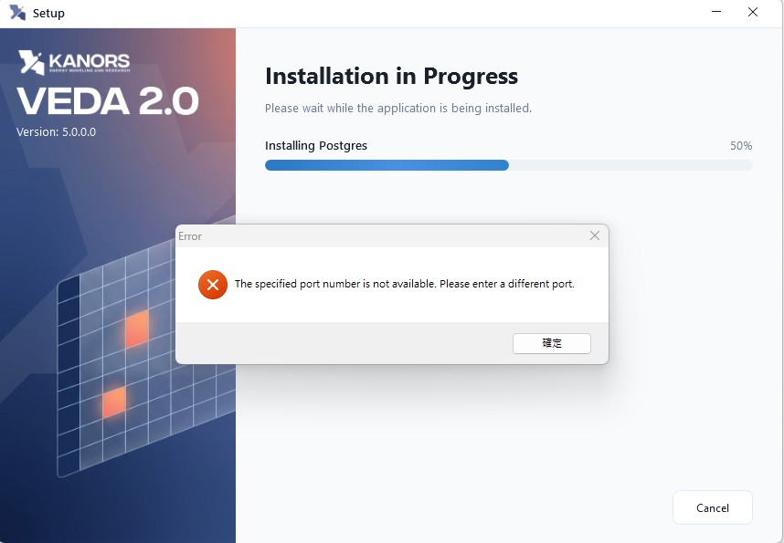
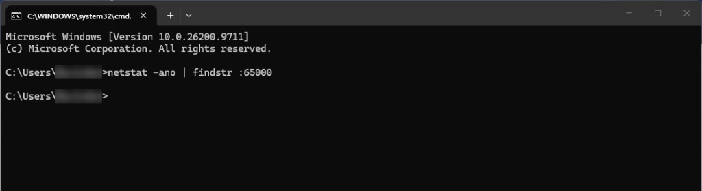
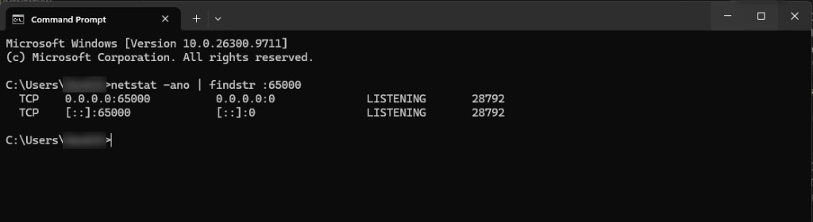

# PostgreSQL - Specified Port Number is Not Available

## Issue

During the installation of VEDA 2.0, the following error message may appear at the "Installing Postgres" stage:



## Possible cause

VEDA 2.0 uses port **65000** for its PostgreSQL database. This error may occur if the port is temporarily unavailable, already in use by another application, or restricted by Windows.

In some cases, the error may appear even when no application or service is actively using the port. This may be due to a temporary issue during the installer's port availability check.

## Resolution

### Step 1: Check port availability

Open Command Prompt and run:

```text
netstat -ano | findstr :65000
```

- **If no results are displayed:** no active connection or listening process was detected on port 65000, as shown below. Proceed to Step 2.

    

- **If results are displayed:** another application or service is using port 65000, as shown below. Resolve the conflict before retrying.

    

### Step 2: Restart the machine

1. Close the error message and exit the VEDA 2.0 installer completely.
2. Restart the machine.
3. After the machine starts again, relaunch the installer and proceed with the installation.

## Additional information

If the issue continues even after restarting the machine and confirming that no application is using the port, contact [KanORS Support](mailto:support@kanors.com).
